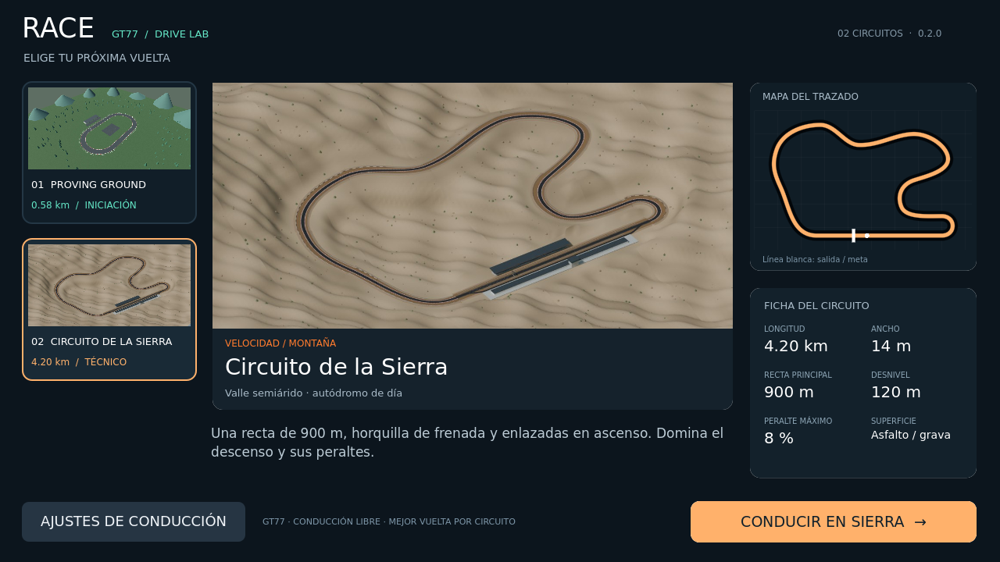

# Race · GT77 Drive Lab

Prototipo de conducción en 3D para Android y PC desarrollado con **Godot 4.5** (renderer GL Compatibility). Versión 0.2.1.



## Contenido del paquete

| Carpeta / archivo | Descripción |
|---|---|
| `Race/` | Proyecto Godot completo: código, escenas, modelos, texturas, selector de pistas, mapas, fichas técnicas y pruebas |
| `Circuito_de_la_Sierra/` | Modelo editable `.blend` de la pista (Blender 4.5), constructor `build_circuit.py` y trazado `design.json` |
| `Circuito_de_la_Sierra/godot/` | Escena independiente de inspección del circuito |
| `optimize_sierra_mobile.py` | Adaptación móvil del modelo de Blender |
| `LEEME_PRIMERO.txt` | Guía rápida de uso del paquete |
| `SHA256SUMS.txt` | Comprobación de integridad del paquete original |

## Qué incluye el juego

- GT77 con cuatro ruedas animadas, tres pinturas y cabina simplificada
- Dos pistas: GT77 Proving Ground y Circuito de la Sierra (4.2 km, peraltes y desnivel de 120 m)
- Suspensión por rueda, neumáticos con deslizamiento, aerodinámica y tracción trasera
- Modos Asistido, Sport y Simulación; ABS y TCS según el modo
- Controles multitáctiles o giroscopio/inclinación con calibración
- Cámaras capó, onboard y tercera persona
- HUD, minimapa, cronómetro, récords por pista, reversa y audio sintetizado

## Abrir el juego

1. Abre `Race/project.godot` en **Godot 4.5** estándar
2. Espera a que termine la importación de recursos
3. Pulsa **F5**, elige pista y pulsa **Conducir**
4. En PC usa WASD/flechas, Espacio, C, V, R y Esc

Consulta [Race/LEEME.md](Race/LEEME.md) para controles, parámetros de física y exportación Android.

## Compilar el APK

Necesitas Godot 4.5 con plantillas de exportación Android, OpenJDK 17 y Android SDK (`platform-tools`, `build-tools 35`). Configura las rutas en *Editor Settings > Export > Android*, y desde `Race/`:

```bash
bash scripts/create_debug_keystore.sh
godot --headless --editor --import
godot --headless --export-debug Android ../outputs/Race_GT77_Sierra_0.2.0.apk
```

La clave de pruebas `Race/build/debug.keystore` está incluida para poder actualizar instalaciones Android existentes sin desinstalar. Si compilas con una clave nueva, deberás desinstalar la versión anterior antes de instalar.

## Modificar la pista (Circuito de la Sierra)

1. Edita `Circuito_de_la_Sierra/Circuito_de_la_Sierra.blend` en Blender
2. Regenera desde la carpeta `Circuito_de_la_Sierra/`:
   ```bash
   blender --background --python build_circuit.py
   blender --background --python ../optimize_sierra_mobile.py
   ```
3. Reimporta `Race/project.godot` en Godot y, si cambias dimensiones del trazado, actualiza `Race/scripts/track_catalog.gd` y sus vistas previas

## Pruebas

```bash
godot --headless --editor --import
godot --headless --fixed-fps 120 --script res://tests/physics_test.gd
godot --headless --fixed-fps 120 --script res://tests/control_test.gd
godot --headless --fixed-fps 120 --script res://tests/track_integration_test.gd
```

Resultados referencia: `Race/tests/results.json`, `Race/tests/control_results.json` y `Race/docs/BUILD_VERIFICATION.json`. La compilación y firma del APK y las pruebas en Godot se verificaron. **No se ha probado en un dispositivo Android físico.** La física usa parámetros aproximados y no está calibrada con telemetría real.

## Cambios en 0.2.1

Ver [Race/CAMBIOS_0.2.1.md](Race/CAMBIOS_0.2.1.md): pedales analógicos por altura del dedo, reubicación de pedales al usar inclinación, amortiguación de guiñada, vibración por suspensión y selector explícito de modo libre.

## Licencias

© 2026 — Todos los derechos reservados por el autor del proyecto (`yankee2311`). Los recursos detallan sus licencias en [Race/FONT_LICENSE.txt](Race/FONT_LICENSE.txt) y [Race/GODOT_LICENSE.txt](Race/GODOT_LICENSE.txt).

Los APK, cachés de importación y claves de firma privadas no se versionan.
