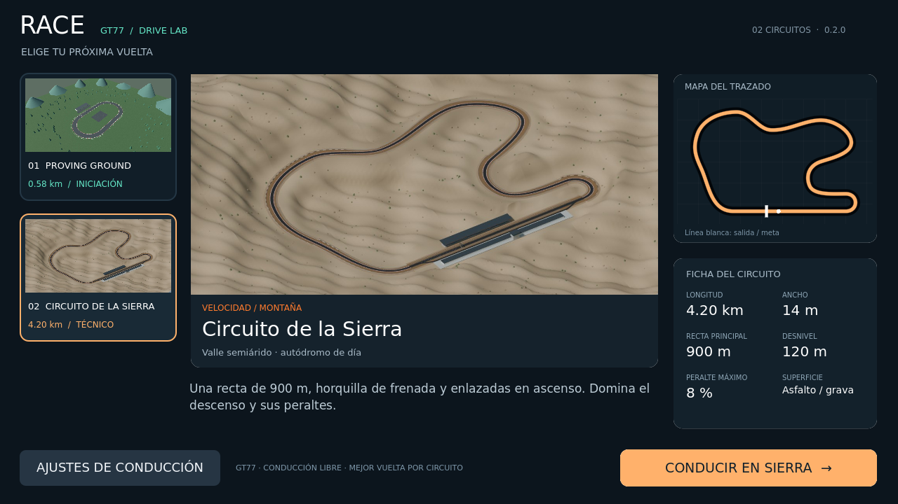

# Race · GT77 Drive Lab

Prototipo de conducción para Android desarrollado con **Godot 4.5.1**.



## Nuevo en 0.2.0

- Selector de dos pistas con vista previa, mapa y ficha técnica.
- Circuito de la Sierra de 4.2 km, peraltes y desnivel de 120 m.
- Minimap adaptativo, récords por pista y físicas diferenciadas de grava.
- [Detalles y pruebas de integración](docs/SIERRA_INTEGRATION.md).

## Incluye

- GT77 con cuatro ruedas animadas, tres pinturas y cabina simplificada.
- Circuito de pruebas, zona de eslalon, obstáculos y colisiones.
- Suspensión por rueda, neumáticos con deslizamiento, aerodinámica y tracción trasera.
- Modos Asistido, Sport y Simulación; ABS y TCS según el modo.
- Controles multitáctiles o giroscopio/inclinación con calibración.
- Cámaras capó, onboard y tercera persona.
- HUD, minimapa, cronómetro, reversa, freno de mano y audio sintetizado.

## Ejecutar

1. Importa `project.godot` en Godot **4.5.1 estándar**.
2. Espera la importación de los recursos.
3. Pulsa **F5**. En PC usa WASD/flechas, Espacio, C, V, R y Esc.

Consulta [LEEME.md](LEEME.md) para controles, parámetros de física y exportación Android.

## Pruebas

```bash
godot --headless --editor --import
godot --headless --fixed-fps 120 --script res://tests/physics_test.gd
godot --headless --fixed-fps 120 --script res://tests/control_test.gd
godot --headless --fixed-fps 120 --script res://tests/track_integration_test.gd
```

Los resultados de la versión 0.2.0 están en `tests/results.json`, `tests/control_results.json` y `docs/BUILD_VERIFICATION.json`. La compilación y firma del APK y las pruebas en Godot se verificaron. **No se ha probado en un dispositivo Android físico.** La física usa parámetros aproximados y no está calibrada con telemetría del vehículo real.

## Estructura

- `scripts/`: conducción, controles, cámaras, interfaz y escenario.
- `assets/`: modelo GLB, texturas, fuentes y licencias.
- `tests/`: pruebas y resultados de referencia.
- `docs/`: capturas y verificación de la compilación.
- `export_presets.cfg`: preset de Android.

Los APK, cachés y claves de firma no se versionan. Para generar una clave local de pruebas, ejecuta `bash scripts/create_debug_keystore.sh` o consulta el comando en la guía.
